# 階段性進度報告：M0–M8

更新日期：2026-10-22 · 路線圖：`plans/2026-10-22_00_roadmap.md` · 逐筆紀錄：`docs/DEVLOG.md`

| 階段 | 內容 | 狀態 |
|---|---|---|
| M0 | 環境與資產：URDF 攤平、Newton 載入、FK 對照 | ✅ 完成：TCP 位置差最大 0.0010 mm |
| M1 | G-code 解析與取樣 | ✅ 完成：範例 3283 點，最大弦差 0.012 mm，15 個 unittest 全過 |
| M2 | 工件座標與 IK | ✅ 完成：FK(IK) 0.0014 mm、0.0011°，直手腕姿態，速度用到上限的 5%。**檢查點 1 通過** |
| M3 | Newton 模擬與 Isaac Sim 渲染 | ✅ 完成：TCP 追蹤 0.0012 mm、非預期碰撞 0、RTX 影片 |
| M4 | Sim2Real 介面 | ✅ 假硬體通過：最大誤差 0.00069 rad（補償 10 ms 延遲後 0.00010 rad）；真機待 FANUC 電腦驗證 |
| M6 | 雙機協作 | ✅ 完成：兩台共用工件、無互撞（最小淨空 78.5 mm）、圍籬、RTX 影片 |
| M7 | 刀具與材料移除 | ✅ 完成：刀具庫、刀尖 IK 與碰撞體、2.5D 高度圖、切削力與偏移估計 |
| M8 | 學生操作 UI | ✅ 完成：viser 網頁，`docs/UI_GUIDE.md` |

---

## M0：環境與資產

| 項目 | 內容 |
|---|---|
| 環境 | `~/envs/aisc_sim`：Python 3.12.15、Newton 1.7.0.dev0、warp 1.17.0、Isaac Sim 6.1.0.0、cuRobo 0.8.0 |
| 機器人模型 | `assets/fanuc_m710id70_spindle/m710id_70_spindle.urdf`（由既有 xacro 攤平）：11 links、6 revolute、4 fixed、16 shapes |
| 對照方法 | 1000 組在關節範圍內均勻抽樣（seed 0），Newton `eval_fk` vs NumPy 直接連乘 URDF 的 origin／axis |

### FK 對照

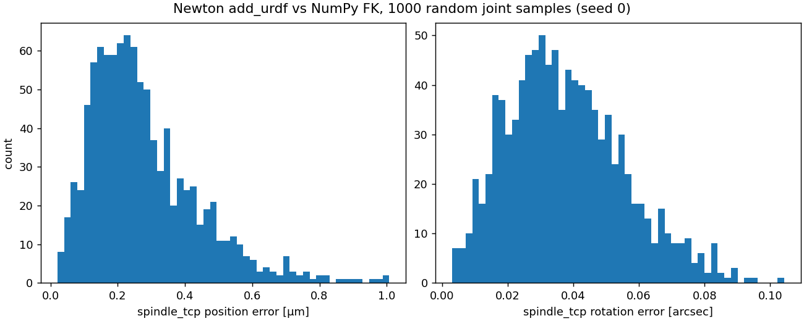

`spindle_tcp` 位置差最大 0.0010 mm、平均 0.0003 mm；姿態差最大 2.9e-5°。差異來自 Newton 用 float32。

### TCP 可達範圍（隨機抽樣）

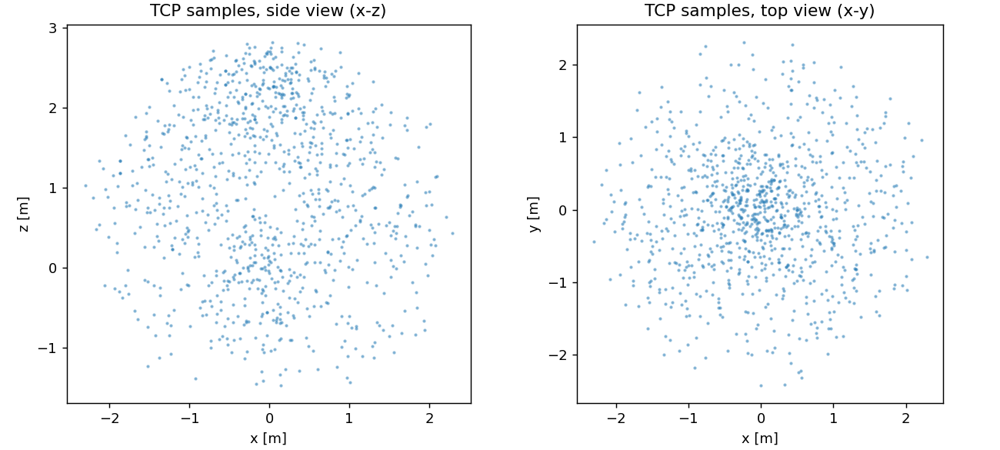

TCP 距 J1 軸最遠 2.43 m，z 範圍 −1.48…2.83 m（含不合理的朝下姿態；實際工作空間由 M2 的 IK 決定）。

### 快照與刀軸方向

| `home`（全 0） | 主軸近拍 |
|---|---|
| 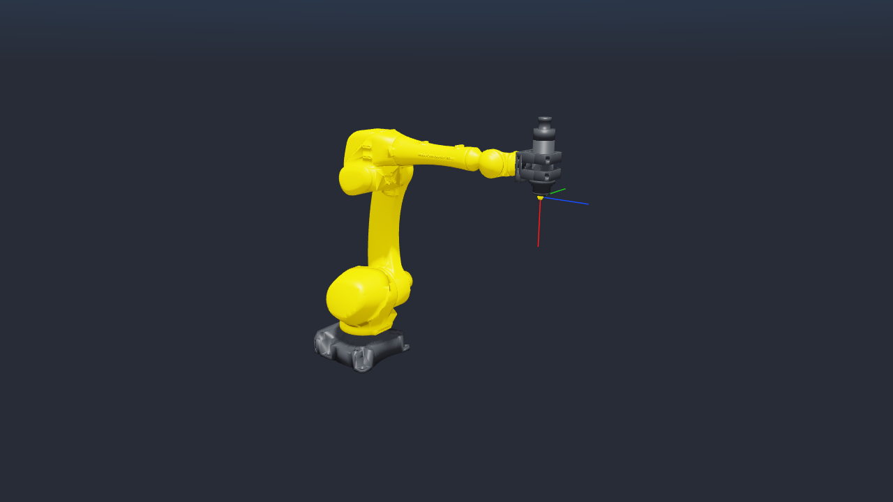 | 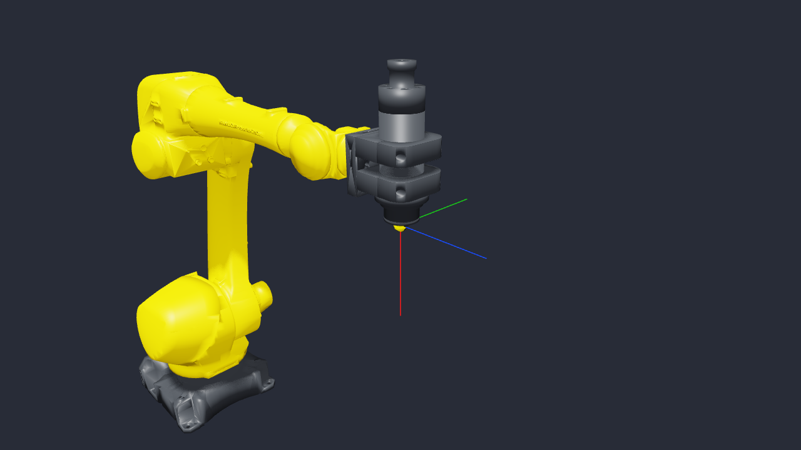 |

黃點是 `spindle_tcp`，紅／綠／藍是它的 +X／+Y／+Z。**刀軸是 +X**（沿主軸指向刀尖，`home` 時朝下）；xacro 註解寫的 +Z 與網格不符，以網格為準（SPEC §3.2）。TCP 偏移本身仍是 ⚠️ UNVERIFIED。

---

## M1：G-code 解析與取樣

| 項目 | 內容 |
|---|---|
| 方言 | SPEC §4：G0/G1/G2/G3（I/J/K 與 R、全圓、螺旋）、G17–19、G20/21、G90/91、G54–59、F、S、M3/M4/M5、M2/M30 |
| 取樣 | 直線 ≤ 1 mm；圓弧弦差 ≤ 0.02 mm |
| 時間律 | 每段梯形、路徑加速度 1 m/s²、轉角 > 5° 停到 0 |
| 範例 | `assets/gcode/sample_pocket_contour.nc`：R10 圓角輪廓、螺旋下刀圓形口袋、S 槽 |

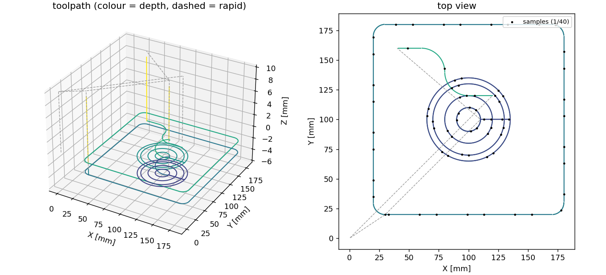

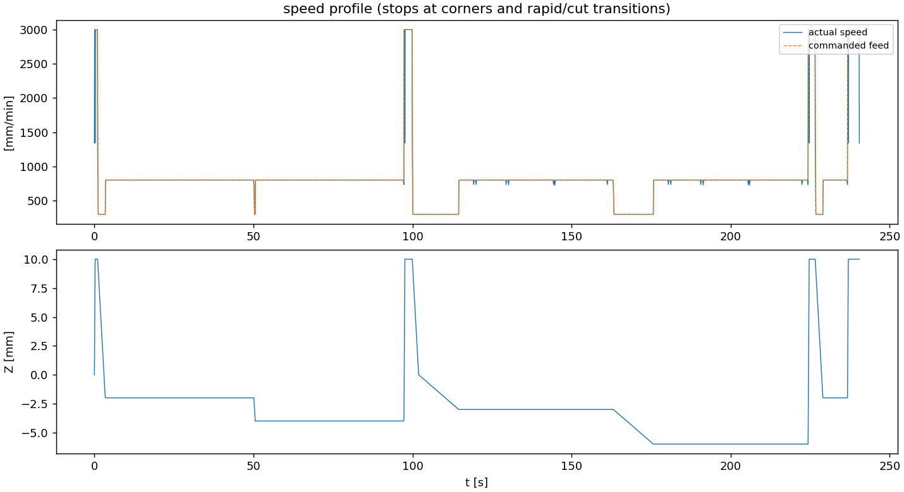

50 段、切削 2804 mm、快速 463 mm；3283 個樣本、最大弦差 0.0124 mm、240.4 s。`tests/test_gcode.py` 15 個測試全過。

---

## M2：工件座標與 IK

| 項目 | 內容 |
|---|---|
| 工件原點（佔位，⚠️ UNVERIFIED） | base 座標 (1.3, −0.1, 0.70) m，程式軸與 base 軸對齊 |
| IK | 5 自由度 LM（位置 ＋ 刀軸 +X），null-space 往 `home` 拉；起點在「收斂且極限餘裕 ≥ 0.1」的解中選離 `home` 最近的 → 直手腕 J4 = J6 ≈ 0、J5 ≈ 43° |
| 軌跡檔 | `outputs/m2_ik/sample_pocket_contour/trajectory/`（SPEC §5） |

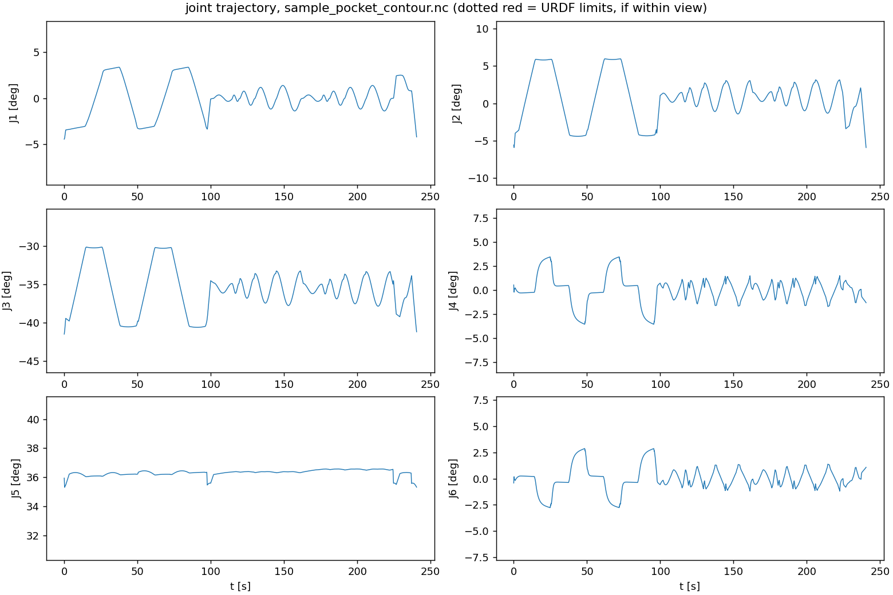

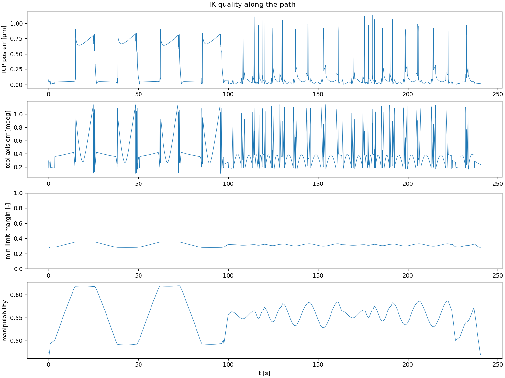

3283 點全部收斂（平均 1.86 次迭代、共 3.1 s）；FK(IK) 位置誤差最大 0.0014 mm、刀軸 0.0011°；相鄰樣本關節差最大 0.22°；關節速度最大只有「上限 × 0.5」的 5.4%；極限餘裕最小 0.25（J3，範圍非對稱）；Newton FK 交叉比對 0.0014 mm。

第一版種子選擇只看極限餘裕，會選到 J5 = −84°、J4／J6 互相補償的扭手腕解；改成「離參考姿態最近」後得到直手腕解（DEVLOG 2026-10-22 M2）。

---

## M3：Newton 模擬與 Isaac Sim 渲染

| 項目 | 內容 |
|---|---|
| 場景 | 機器人（URDF）、工作台 0.8 × 1.0 × 0.7 m、工件 200 × 200 × 50 mm（佔位尺寸），工件半透明 |
| 重播 | 60 Hz 運動學重播，14,427 frames，33 s |
| 碰撞 | `CollisionPipeline` 有號距離；預期 = 主軸在切削段或純退刀時進工件 |
| 渲染 | Newton GL（開發）、USD → Isaac Sim 6.1 RTX（交付） |

| Newton GL 近拍（10 倍速） | Isaac Sim RTX |
|---|---|
| 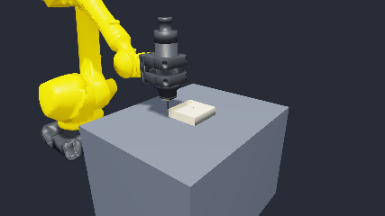 | 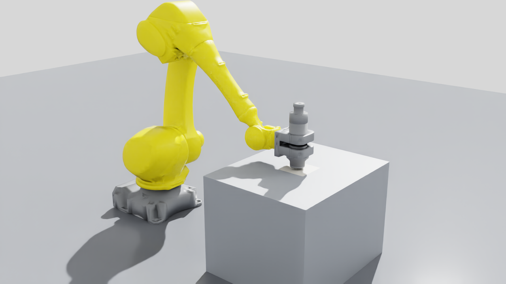 |

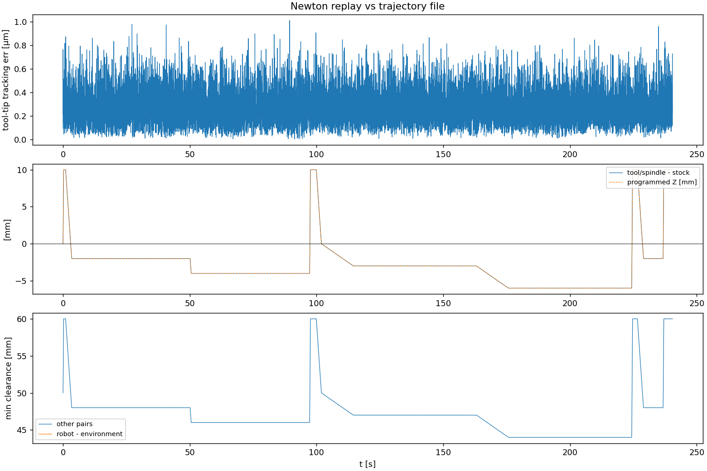

TCP 追蹤誤差最大 0.0012 mm；非預期碰撞 0 frames；主軸–工件最深 −2.001 mm = 程式最深 6 mm − 網格刀尖差 4 mm；主軸–工作台最近 48 mm。MP4 與 USD 不進 git（`outputs/m3_sim/sample_pocket_contour/`：`replay_overview.mp4`、`replay_closeup.mp4`、`rtx/render.mp4`、`scene.usd`）。

---

## M4：Sim2Real 介面

| 項目 | 內容 |
|---|---|
| 套件 | `ros2_ws/src/milling_bridge`：`trajectory_player`、`joint_state_recorder`、假硬體 launch |
| 安全預設 | `dry_run=true`、`speed_scale=0.1`、先以 ≤ 0.2 rad/s 走到第一點 |
| 測試 | 100 mm 正方形軌跡（`outputs/m2_ik/unit_square_100mm`）在 ros2_control 假硬體上以 speed_scale 2.0 播放 |

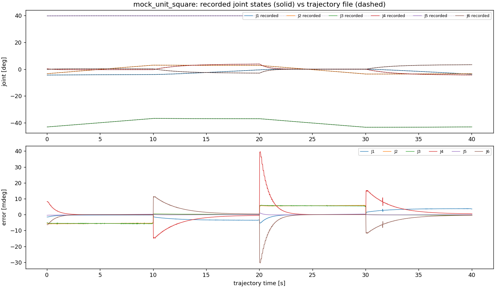

兩個 goal 都成功；關節曲線與軌跡檔最大誤差 0.00069 rad（0.04°），對應約 10 ms 控制器延遲；補償後 0.00010 rad。真機測試要在接 FANUC 的電腦上做（`ros2_ws/README.md`），而且在 TCP 偏移確認前只在空中、不裝刀。

## M6：雙機協作

| 項目 | 內容 |
|---|---|
| cell | `configs/cells/dual_robot_table.yaml`：兩台 M-710iD/70 對向 3.0 m，共用 600 × 200 × 50 mm 工件，各切自己那端 200 × 200、中間留 200 mm；圍籬 6.4 × 4.8 × 2 m（半透明護板、−Y 入口）、地板、控制櫃 |
| 程式 | fanuc_1：`sample_pocket_contour.nc`（240 s）；fanuc_2：`sample_face_boss.nc`（312 s） |
| 重播 | 共用 60 Hz 時間軸 18,731 frames；機器人間淨空用 Warp 無號 mesh 查詢（SPEC §6.2） |

| Isaac Sim RTX 全景 | Newton GL 近拍（10 倍速） |
|---|---|
| 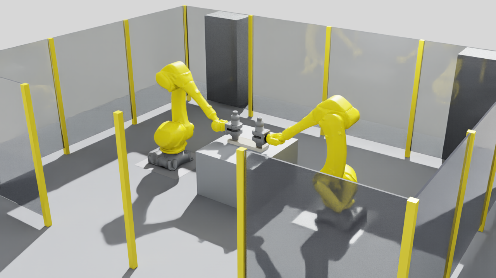 | 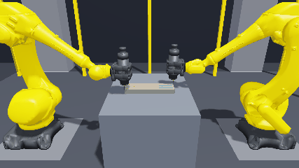 |

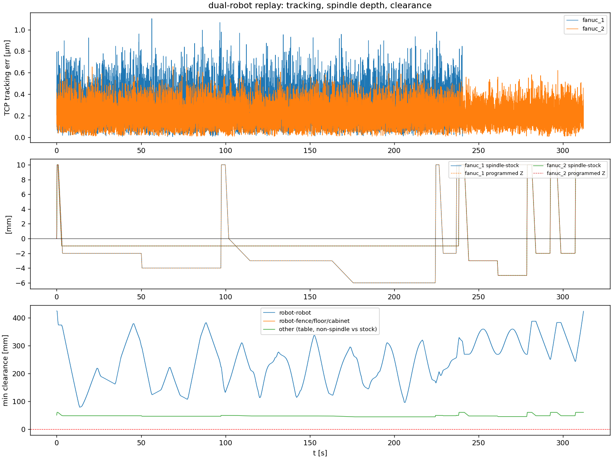

兩台 TCP 追蹤誤差 ≤ 0.0011 mm；非預期碰撞 0 frames；兩台之間最小淨空 78.5 mm（兩支主軸）；與圍籬、控制櫃無接觸；主軸–工件深度與程式一致。影片：`outputs/m6_dual/replay_{overview,closeup,side}.mp4`、`rtx_{overview,closeup,side}/render_*.mp4`（不進 git）。

要記得：擺位、工件、圍籬尺寸都是佔位值（SPEC ⚠️ UNVERIFIED）；Newton 的 mesh–mesh 接觸候選不能當淨空（DEVLOG 2026-10-22 M6）。

---

## M7：刀具與材料移除

| 項目 | 內容 |
|---|---|
| 刀具 | `configs/tools/`（flat 10／6 mm、ball 8 mm）；刀尖 = 鼻端 + 長度 × 刀軸；IK 目標、Newton 圓柱碰撞體、視覺 |
| 材料移除 | 2.5D 高度圖（0.5 mm），Warp kernel，單元測試對解析體積 < 2% |
| 力與偏移 | k_c × MRR／v_c；關節扭轉彈簧靜態柔性（佔位參數） |

| 加工後高度圖（單機） | MRR／力／偏移 |
|---|---|
| 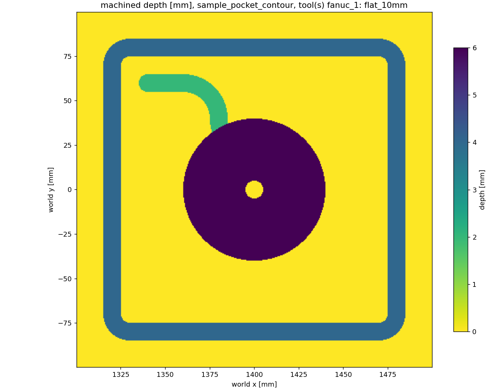 | 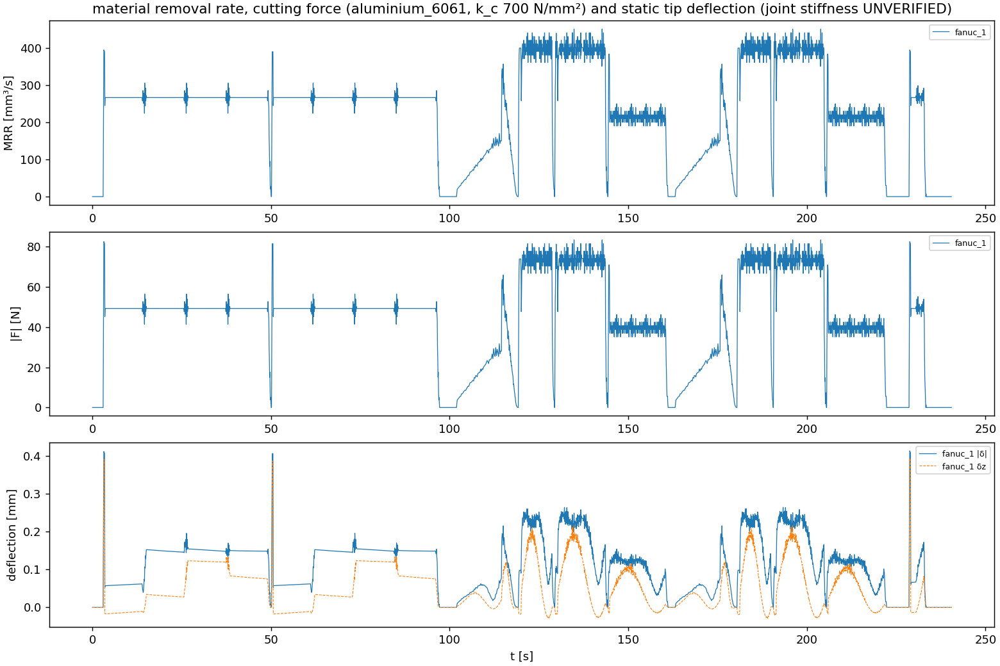 |

單機：移除 55,812 mm³、最深 6.00 mm、力最大 83 N、刀尖偏移最大 0.39 mm。雙機共用工件：總移除 88,426 mm³（`outputs/m7_removal/dual_shared_stock/`）。

## M8：學生操作 UI

`scripts/m8_ui.py` 起 viser 網頁（<http://localhost:8080>）：選 cell、上傳 G-code、刀具庫與自訂刀具、工件位置、材料；一鍵執行（解析 → IK → Newton 碰撞 → 材料移除）、3D 動畫、結果、匯出軌跡給 bridge。指南：`docs/UI_GUIDE.md`。
